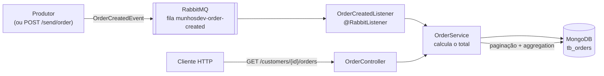

# order-ms

Microsserviço de pedidos orientado a eventos. Ele consome eventos de "pedido criado" de uma fila do **RabbitMQ**, calcula o total de cada pedido e guarda o resultado no **MongoDB**. Uma API REST lista os pedidos de um cliente com paginação, e o valor total gasto pelo cliente é calculado com uma **aggregation** do MongoDB.

## Arquitetura



1. Um produtor publica um `OrderCreatedEvent` em JSON na fila `munhosdev-order-created`. Para facilitar os testes, o próprio serviço tem o endpoint `POST /send/order`, que publica o evento na fila.
2. O `OrderCreatedListener` consome a mensagem, convertida pelo `Jackson2JsonMessageConverter`.
3. O `OrderService` converte o evento em um documento `Order`, calcula `total = Σ (preço × quantidade)` e persiste em `tb_orders`. Os valores monetários são gravados como `Decimal128`, e `customerId` tem índice.
4. `GET /customers/{customerId}/orders` devolve os pedidos paginados e, em `summary.totalOnOrders`, a soma de todos os pedidos do cliente, calculada no próprio MongoDB com `$match` + `$group`.

## Tecnologias

- Java 21
- Spring Boot 3.3 (Web, Data MongoDB, AMQP)
- RabbitMQ 3.13 (com o plugin de management)
- MongoDB
- springdoc-openapi (Swagger UI)
- Lombok
- Docker Compose

## Como rodar localmente

Pré-requisitos: Java 21 e Docker. Não é preciso instalar o Maven: o projeto usa o Maven Wrapper.

```bash
# 1. Suba o MongoDB e o RabbitMQ
docker compose -f local/docker-compose.yml up -d

# 2. Rode a aplicação (no Windows, use mvnw.cmd)
./mvnw spring-boot:run
```

A aplicação sobe em `http://localhost:8080`.

| Serviço | Endereço | Credenciais |
|---|---|---|
| MongoDB | `localhost:27017` | `admin` / `132` (authSource `admin`) |
| RabbitMQ (AMQP) | `localhost:5672` | `munhosdev` / `munhosdev`, vhost `munhos-dev` |
| RabbitMQ Management | http://localhost:15672 | `munhosdev` / `munhosdev` |

As filas `munhosdev-order-created` e `munhosdev-order-test` são criadas automaticamente quando a aplicação sobe.

## Documentação da API (Swagger)

- Swagger UI: http://localhost:8080/swagger-ui.html
- OpenAPI (JSON): http://localhost:8080/v3/api-docs

## Endpoints

### `POST /send/order`: publica um evento de pedido criado

Publica o corpo da requisição na fila `munhosdev-order-created`. O pedido é salvo de forma assíncrona pelo listener. A resposta é `200 OK`, sem corpo.

O arquivo [`payload.json`](payload.json) tem um exemplo pronto:

```bash
curl -X POST http://localhost:8080/send/order \
  -H "Content-Type: application/json" \
  -d @payload.json
```

```json
{
  "codigoPedido": 1001,
  "codigoCliente": 1,
  "itens": [
    { "produto": "lápis",   "quantidade": 100, "preco": 1.20 },
    { "produto": "caderno", "quantidade": 100, "preco": 1.60 }
  ]
}
```

O evento também pode ser publicado direto na fila `munhosdev-order-created` pelo RabbitMQ Management (Queues → Publish message), com o header `content_type = application/json`.

### `GET /customers/{customerId}/orders`: lista os pedidos de um cliente

| Parâmetro | Tipo | Padrão |
|---|---|---|
| `page` | query | `0` |
| `pageSize` | query | `10` |

```bash
curl "http://localhost:8080/customers/1/orders?page=0&pageSize=10"
```

Resposta `200 OK`, depois de publicar o `payload.json` e um segundo pedido de R$ 5,00:

```json
{
  "summary": {
    "totalOnOrders": 285.00
  },
  "data": [
    { "orderId": 1001, "customerId": 1, "total": 280.00 },
    { "orderId": 1002, "customerId": 1, "total": 5.00 }
  ],
  "pagination": {
    "page": 0,
    "pageSize": 10,
    "totalElements": 2,
    "totalPages": 1
  }
}
```

## Estrutura do projeto

```
src/main/java/br/com/munhosdev/orderms
├── config/       # Filas e conversor JSON do RabbitMQ
├── controller/   # OrderController (consulta) e SenderController (publica eventos de teste)
├── domain/       # Documentos Order e OrderItem
├── listener/     # OrderCreatedListener e os DTOs do evento
├── repository/   # OrderRepository (Spring Data MongoDB)
└── service/      # Regras de negócio, aggregation e envio de mensagens
```
